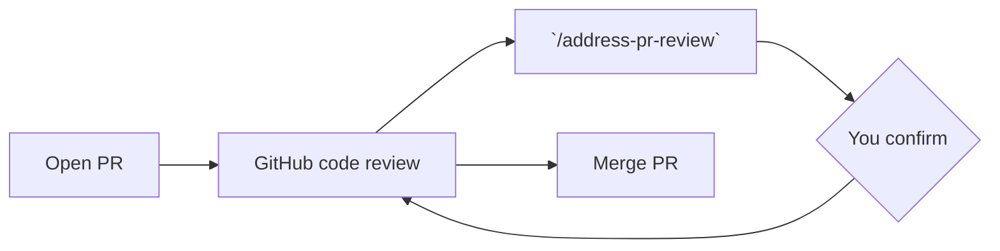

# Address PR Review

An agent skill that **reads pull request comments and CI failures and fixes them** — then
stops and asks you before publishing anything.

Works in Claude Code, Codex, Cursor...

> This is a fork of [mnapoli/skill-address-pr-review](https://github.com/mnapoli/skill-address-pr-review).
> Nothing is pushed or replied to without explicit confirmation, threads you already
> replied to yourself are skipped, and a 👀 reaction pulls a skipped thread back in.
> See [Differences from upstream](#differences-from-upstream).



Open a PR and invoke `/address-pr-review` in Claude Code (or `$address-pr-review` in Codex):

- Fixes CI failures
- Reads inline pull request comments — ignores resolved ones, and ones you already replied to
- Re-checks a thread you replied to when you react 👀 to it
- **Judges each suggestion before implementing it** — a bot asking is not a reason to change code
- Makes code changes
- Reports what it changed and the exact replies it proposes — and waits for your go-ahead
- Replies in the language the thread is written in (a German thread gets a German reply)
- Pushes and replies to each thread **only after you confirm**


## Prerequisites

- [GitHub CLI](https://cli.github.com/) (`gh`) installed and authenticated
- Claude Code, Codex, Cursor, or [any agent system that can run shell commands and make code changes](https://agentskills.io/home#where-can-i-use-agent-skills)

## Installation

### In Claude Code

Clone into your Claude Code skills directory:

```bash
git clone git@github.com:MartinVanVan/address-pr-review.git ~/.claude/skills/address-pr-review
```

### In other systems

Most other agent systems read from a ".agents/skills" directory:

```bash
git clone git@github.com:MartinVanVan/address-pr-review.git ~/.agents/skills/address-pr-review
```

## Usage

From a branch with an open PR:

```
/address-pr-review
```

The agent fetches unresolved threads and CI failures and fixes the issues. It may commit
locally, but it will **not** push, reply, or resolve anything until you say so. When it
stops, you get:

- what it changed per thread / CI failure, and what it deliberately left alone
- which threads were 👀 re-checks, and what it concluded on the second look
- **the intended reply for every thread, verbatim** — the text as it would be posted, not a summary of it
- whether it would resolve the thread and clear the 👀
- the commits it would push, and to which branch

One block per thread, like this:

```text
### src/Invoice.php:212 — coderabbitai                [👀 re-check]
Comment:  Null check is unreachable after the early return   https://github.com/…#discussion_r123
Action:   dropped the dead branch, src/Invoice.php:212-218
Reply:
  > Fixed as suggested.
Resolve:  yes          Clear 👀: yes
```

Approve all of it, part of it, or none of it. Edit a reply and it sends your wording
instead — the agent posts the approved text as-is, it does not re-word it.

Replies, resolutions and pushes go out **as your own GitHub account** — `gh`'s
authenticated user. There is no bot identity, so a reply is indistinguishable from one you
typed yourself. That is also why the skill asks first.

## Suggestions are judged, not obeyed

The point of failure for a skill like this is not a bad reply — it is quietly implementing
every suggestion a bot makes. CodeRabbit and friends emit correct findings, style
opinions and confident misreadings in the same voice, and an agent that treats each one as
a work order will happily degrade the code on request.

So the burden of proof sits on the suggestion. Each thread gets a verdict, shown to you at
the confirmation gate with a one-sentence reason:

| Verdict | What happens |
|---|---|
| correct, worth doing | change is made |
| correct but trivial | fixed only if a genuine one-liner, otherwise declined |
| wrong | declined, with what the reviewer misread |
| out of scope | declined — real, but not something this PR introduced |
| unclear | you are asked, rather than the agent guessing |

A run that declines several threads is working correctly. If it never declines anything,
be suspicious of it.

CI failures are exempt: a failing job is a fact, not a claim. The rule there is to fix the
cause — never to green a job by weakening an assertion, skipping a test or loosening a type.

## CodeRabbit threads are never auto-resolved

CodeRabbit resolves its own threads once it has verified a fix — on every venabo PR
checked, its threads carry `resolvedBy: coderabbitai[bot]`. So the skill does not resolve
them. Closing one ourselves pre-empts that verification and discards the only independent
confirmation that the change actually answers the comment.

Instead a CodeRabbit thread gets one ordinary reply: a written-out explanation of what
changed and what did not. **No `@`-mention.** A plain reply in its own thread is already
enough for CodeRabbit to re-check and post its verdict ("Confirmed as addressed by ..."); a
ping on top only makes it analyse the same thread a second time for the same answer. The
thread stays open until CodeRabbit itself closes it.

The explanation matters more here than on a human thread. "Fixed as suggested." is fine for
a reviewer who can read the diff; CodeRabbit is about to decide whether to resolve the
thread, and a vague reply gets a vague re-check — it re-raises a point you answered, or
resolves one you never did.

The reply goes out in the thread's language. CodeRabbit's language is a per-project setting
rather than an accident, so a German thread gets a German reply:

```bash
bash ./reply-to-thread.sh "<thread_id>" \
  "Behoben in src/Foo.php:42 — die Null-Prüfung entfernt. Punkt zwei bleibt, weil ..."
```

Every CodeRabbit thread you acted on gets a reply, declines included — nothing else closes
them, and the reasoning behind a decline belongs on record as much as a fix does.

The skill never posts a top-level PR comment either: a PR-level `@coderabbitai review`
would trigger a full fresh pass, detached from the thread it was meant to answer.

`--resolve` on a CodeRabbit thread is refused (exit 65); `--force-resolve` overrides it if
you really mean to. Human threads are unaffected and resolve as before.

## Reply language

Replies match the language the thread is conducted in — a German thread gets a German
reply, an English one an English reply. The language is taken from your own comment in the
thread if you left one, otherwise from the most recent human reviewer, otherwise from the
language the thread opened in. That last one includes CodeRabbit's own comment: its
language is configured per project, not an accident to be corrected. The human signals rank
higher only so a thread that has switched language mid-way follows the people in it.

Code identifiers, file paths, translation keys, quoted code and log output are left
untranslated.

## The 👀 re-check flag

Because the skill skips threads you have replied to, it needs a way for you to say *"look
at this one again"*. That signal is a 👀 reaction:

1. React 👀 to any comment in the thread — on GitHub, in the PR diff.
2. Re-run `/address-pr-review`. The thread comes back with `flaggedByEyes: true` and the
   agent treats it as a re-check: it reads your earlier reply as context and works out what
   changed or was missed, rather than answering from scratch.
3. Once the thread is dealt with, the agent passes `--clear-eyes`, which removes your
   reaction. The flag is **one-shot** — without this the thread would be reprocessed on
   every subsequent run.

Only **your** 👀 counts. Bots (CodeRabbit among them) use 👀 as an "I'm looking at this"
acknowledgement, and counting theirs would drag threads back in at random.

Resolved threads stay out of scope regardless — 👀 re-opens a skipped thread, not a closed one.

## Differences from upstream

| | Upstream | This fork |
|---|---|---|
| Push & reply | Automatic, at the end of the run | Requires explicit confirmation in chat |
| Thread selection | All unresolved threads | Unresolved threads you have **not** commented in |
| Re-check signal | — | 👀 reaction re-opens a skipped thread, consumed via `--clear-eyes` |
| CodeRabbit threads | Resolved like any other | Replied to, never resolved — CodeRabbit closes its own |
| Reply language | Unspecified | Matches the thread's language |
| `context: fork` | Enabled | Removed — a forked run can't stop to ask you mid-flight |
| Pre-approved tools | All helper scripts | Only the two read-only ones; `reply-to-thread.sh` still prompts |

To get the full unresolved list, including threads you replied to and did not flag:

```bash
bash ./get-unresolved-threads.sh --include-mine
```

## Tips

1. Run Claude Code's [code review in GitHub Actions](https://code.claude.com/docs/en/github-actions) for automatic reviews on every push
2. Run [Codex code review](https://developers.openai.com/codex/integrations/github/) as well
3. Review Claude and Codex's comments and "mark as resolved" those that don't make sense — or just reply to them yourself, this fork skips those too
4. Review the code yourself: open comments inline the PR diff
5. Launch `/address-pr-review` locally so that all comments are addressed
6. Read the proposed changes and replies, then confirm
7. Not happy with how a thread was handled? React 👀 to it and run the skill again
8. Repeat until the PR is ready to merge

## Limitations

- Job logs are only fetched for GitHub Actions check runs; other providers are listed with a link to their own UI
- CI status comes from the REST check-runs endpoint, so legacy commit statuses (older external CI that posts statuses rather than check runs) are not seen
- No pagination: at most 100 threads per PR, 50 comments per thread, 20 👀 reactions per comment. These sizes are capped by GitHub's 500,000-node query budget (100 × 50 × 20 = 100,000) — raising them can make the query fail on *every* PR
